# Omarchy 01 Theme

Deep violet armor, lime energy, and a lilac focus line. The desktop reads like a Unit 01 cockpit instead of a generic neon terminal dump.

## Preview


## Install

Use the Omarchy theme installer:

```bash
omarchy-theme-install https://github.com/OldJobobo/omarchy-01-theme
```

## Compatibility

- Omarchy 4 / Quattro uses `colors.toml` for generated app integrations, `shell.toml` for native shell surfaces, and `hyprland.lua` for the window treatment.
- Omarchy 3.8 compatibility is retained through `hyprland.conf`, Waybar, Walker, Mako, SwayOSD, and Hyprlock theme files.
- Generated Quattro files without theme-specific overrides are left uncommitted so newer Omarchy templates can add support automatically.

## What's Included

- Hand-tuned Quattro `shell.toml` with lilac gradient borders, dim unselected launcher/menu text, and red alert states
- Sharp Hyprland framing with blur and void-shadow depth
- `evangelion.nvim` as the Neovim colorscheme
- Optional `waybar-theme/` for the older custom bar silhouette

## Wallpapers

<table>
  <tr>
    <td>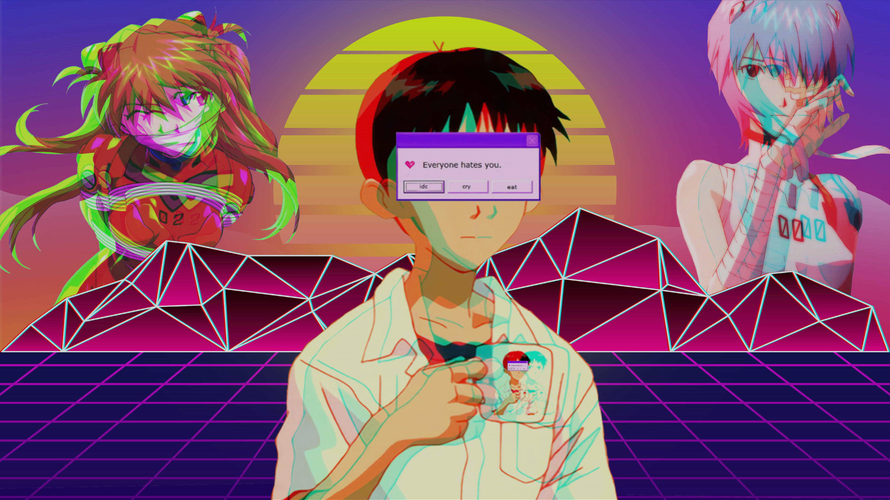</td>
    <td>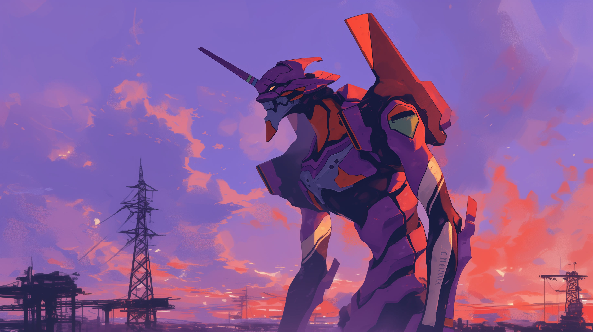</td>
    <td>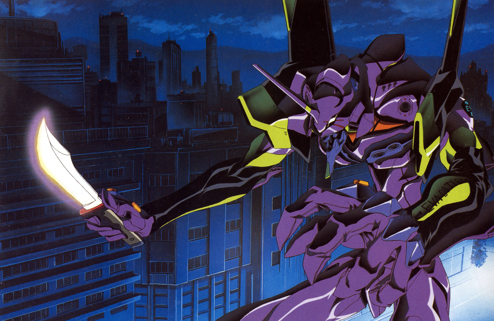</td>
  </tr>
  <tr>
    <td>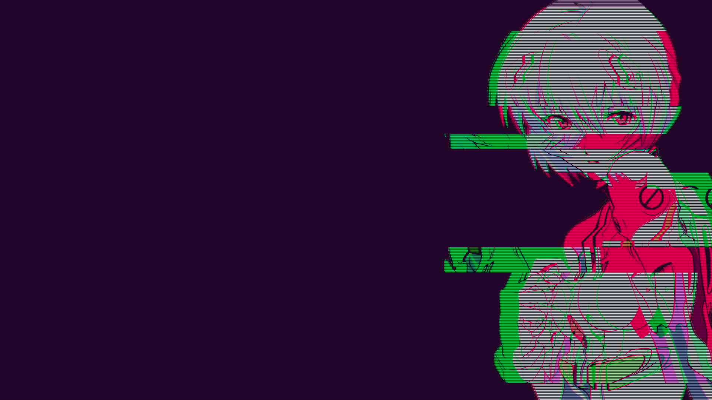</td>
    <td>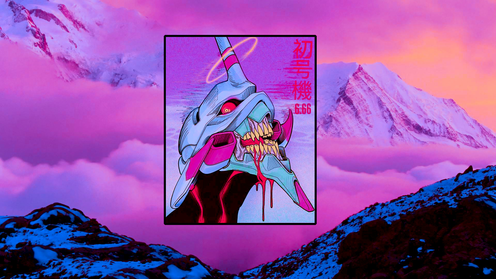</td>
    <td>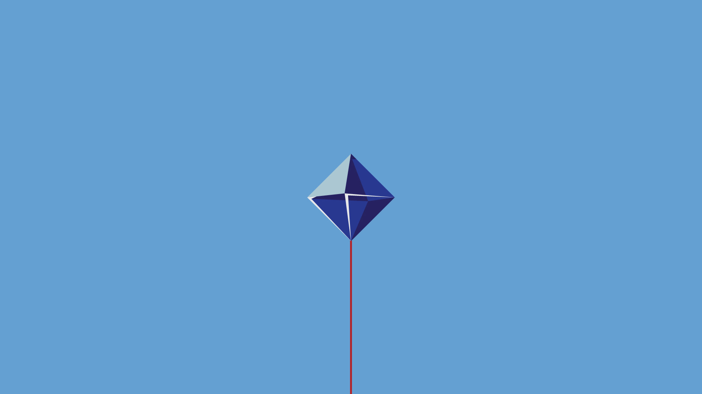</td>
  </tr>
  <tr>
    <td></td>
    <td>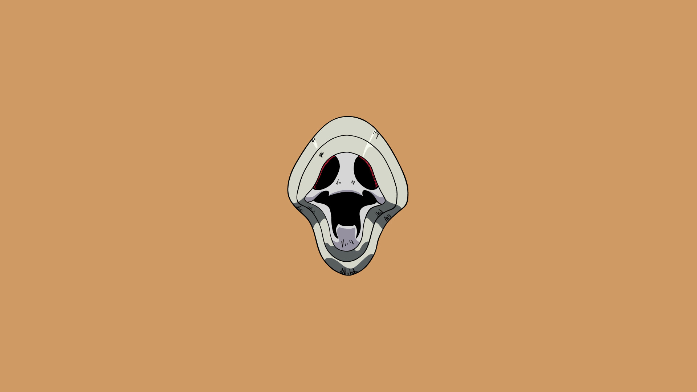</td>
    <td>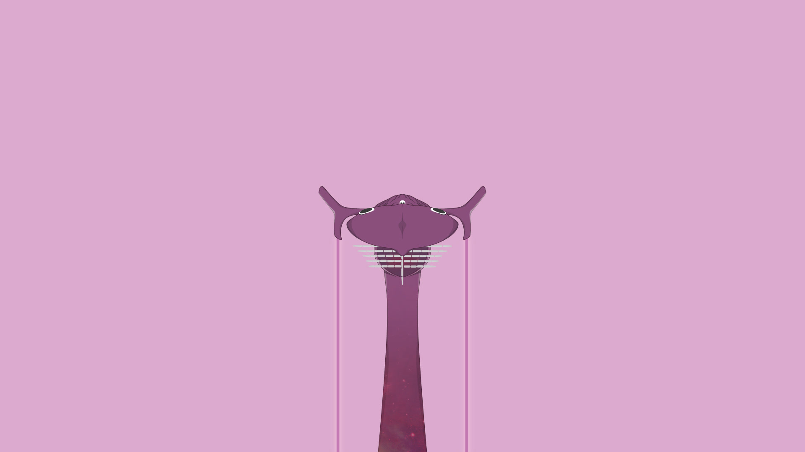</td>
  </tr>
  <tr>
    <td></td>
    <td>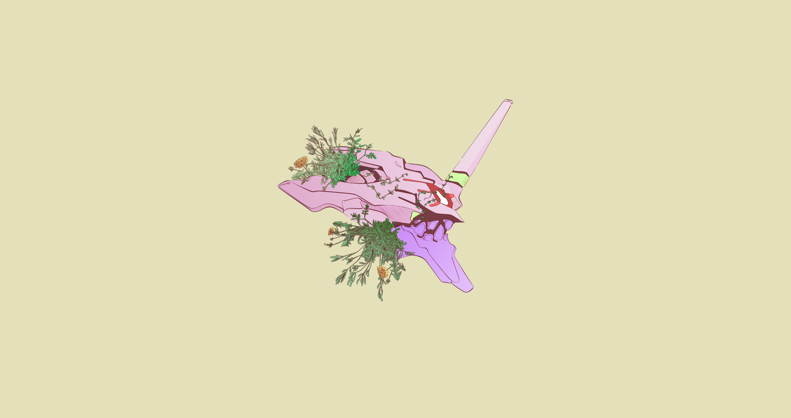</td>
    <td>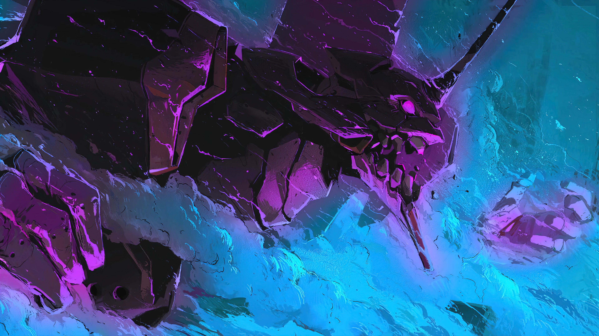</td>
  </tr>
  <tr>
    <td>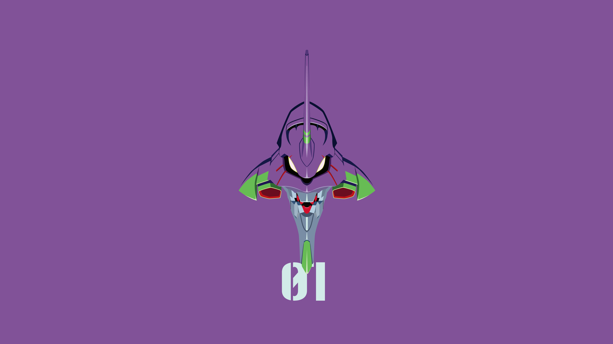</td>
    <td>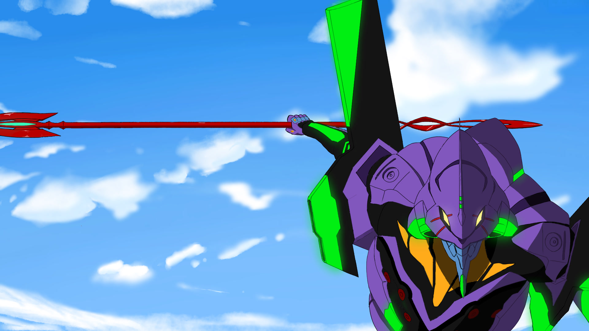</td>
    <td>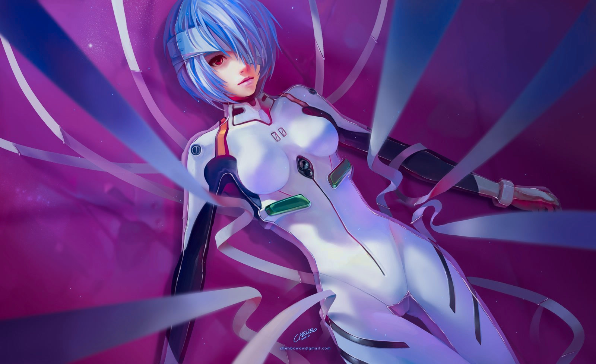</td>
  </tr>
  <tr>
    <td></td>
    <td></td>
    <td>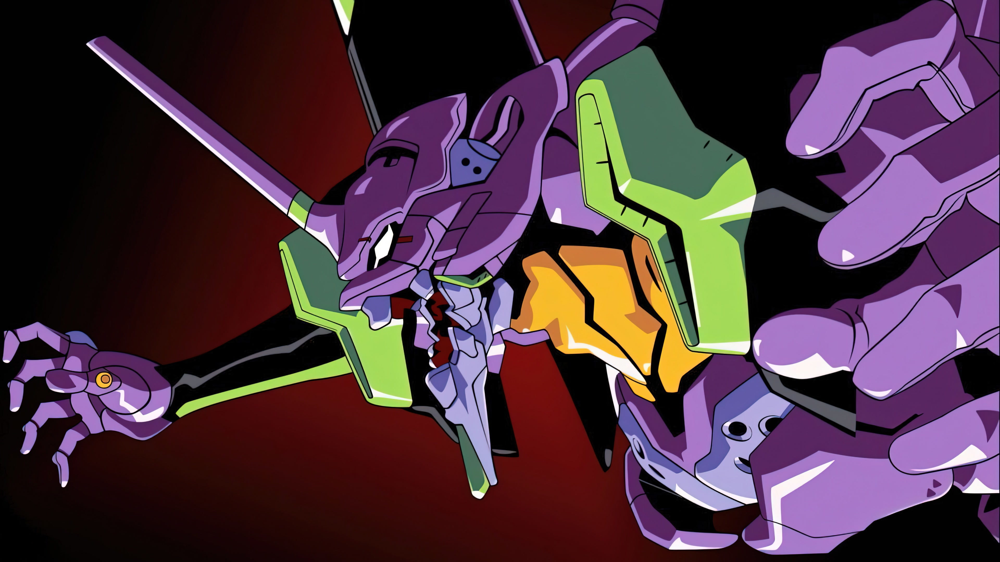</td>
  </tr>
  <tr>
    <td></td>
  </tr>
</table>

Optional animated backgrounds for third-party wallpaper tools: `19-pixel-unit01.mp4`, `20-hacking-system.mp4`, `21-fatal-error-screen.mp4`, and `shatter-mosaic-9285.mp4`. Stock Omarchy stills-only wallpaper pickers will ignore them. `20-hacking-system.mp4` is about 18MB.

## Requirements

- `Yaru-purple` icon theme

## Attribution

- Palette based on the evangelion.nvim colorscheme by xero.style
